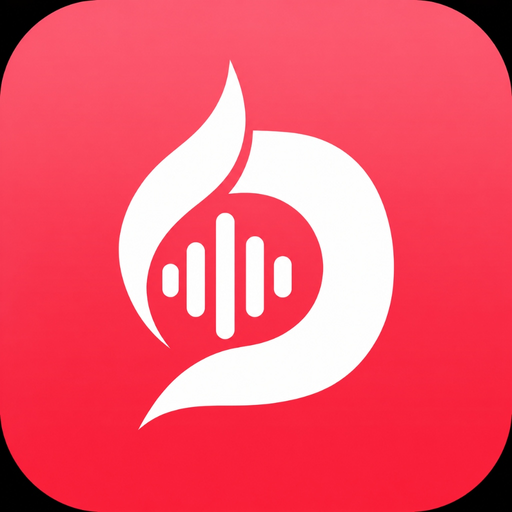
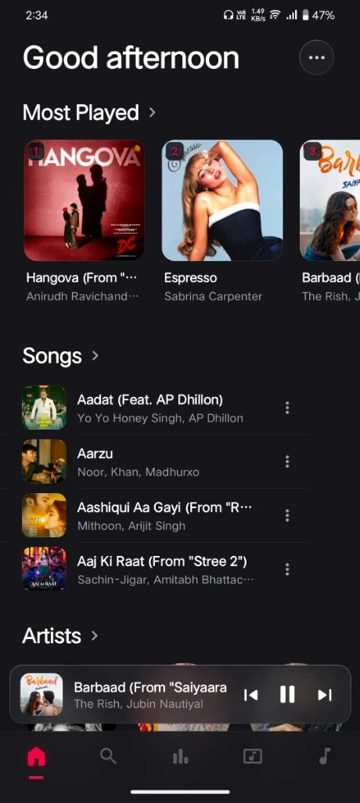
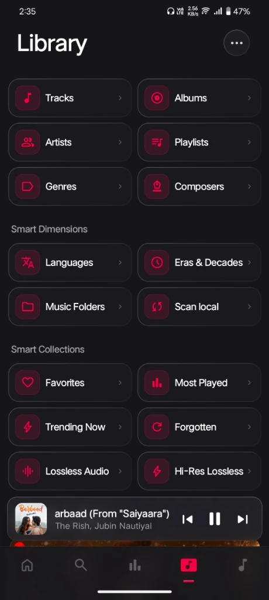
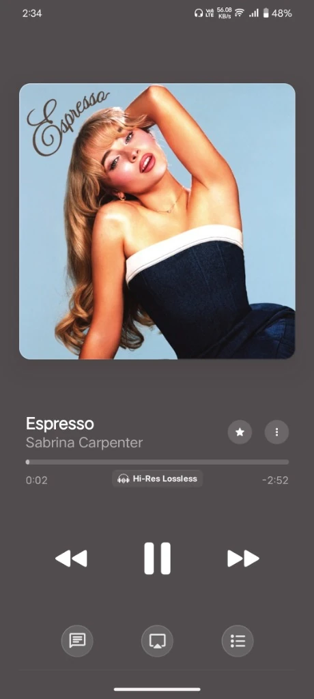
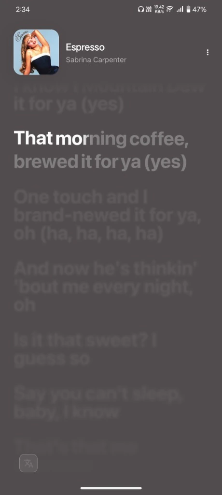

<div align="center">



# DarkMusic

### *Audiophile-Grade, Ultra-Responsive Music Player for Android & Windows*

[](https://github.com/shakti69/DarkMusic/releases/tag/v1.5.11)
[-3DDC84?style=for-the-badge&logo=android&logoColor=white)](https://github.com/shakti69/DarkMusic/releases/tag/v1.5.11)
[](https://github.com/shakti69/DarkMusic/releases/tag/v1.5.11)
[](https://github.com/shakti69/DarkMusic)
[](LICENSE)

<br/>

<p align="center">
  <b>DarkMusic</b> is a high-performance offline & cloud streaming music player engineered for listeners who demand pristine audio quality, zero-latency navigation, and sleek aesthetics. Featuring a native <b>Jetpack Compose</b> Android companion and a hardware-accelerated <b>Wails v3 + Go</b> Windows desktop client, DarkMusic delivers fluid 120 FPS scrolling, syllable-level synchronized bilingual lyrics, Apple Music-style lyrics sharing, bit-perfect audio playback, and versatile local & cloud music streaming.
</p>

</div>

---

## 📥 Download Center (v1.5.11)

Pre-compiled production binaries are available below:

| Platform | Distribution Package | Description | Binary Size | Download |
| :--- | :--- | :--- | :---: | :---: |
| 📱 **Android** | `DarkMusic.apk` | **Latest Official Release** (v1.5.11)<br/>*Signed, R8-optimized, Apple Music share cards, OTA updater, $O(N)$ deduplication* | **`30.3 MB`** | [**Download APK**](https://github.com/shakti69/DarkMusic/raw/main/DarkMusic.apk) |
| 📱 **Android** | `DarkMusic-Universal.apk` | **Full Universal Standalone App** (v1.5.11)<br/>*Complete standalone package with all native ABIs bundled (arm64, armv7, x86_64)* | **`86.9 MB`** | [**Download Full APK**](https://github.com/shakti69/DarkMusic/raw/main/DarkMusic-Universal.apk) |
| 🖥️ **Windows** | `DarkMusic-Installer.exe` | Windows Setup Installer (x64)<br/>*Auto-installs shortcuts, protocol handler & updater* | **`15.9 MB`** | [**Download Setup**](https://github.com/shakti69/DarkMusic/raw/main/DarkMusic-Installer.exe) |
| 🧳 **Windows** | `DarkMusic.exe` | Portable Executable (x64)<br/>*Zero installation required, run from USB or any folder* | **`35.8 MB`** | [**Download Portable**](https://github.com/shakti69/DarkMusic/raw/main/DarkMusic.exe) |

---

## 📸 Interface Preview

<div align="center">

| Home Dashboard | Track Library | Now Playing | Synced Lyrics |
| :---: | :---: | :---: | :---: |
|  |  |  |  |
| *Personalized mix & recent tracks* | *Instant search & $O(N)$ dedup* | *Dynamic theme & audio controls* | *Karaoke sync & tap-to-seek* |

</div>

---

## ✨ Core Features

### ⚡ 1. Hyper-Optimized 120 FPS Engine & Smart Search
- **Zero-Allocation Scroll Pipeline**: Virtualized lists backed by precomputed metadata indices eliminate recomposition churn and garbage collection spikes.
- **Precision Search Ranking**: Instant $O(1)$ search scoring guarantees exact title matches appear first at the top, eliminates false-positive prefix hits, and respects canonical deduplication.
- **Canonical $O(N)$ Track Deduplication**: Intelligent caching deduplicates identical titles across local storage and cloud catalogs in linear time.
- **Hardware-Accelerated UI**: Engineered with Jetpack Compose on Android and GPU-accelerated WebKit/Blink on Desktop for smooth 60, 90, 120, and 144 Hz display refresh rates.

### 🎧 2. Bit-Perfect Audiophile Playback
- **Native Audio Pipeline**: Low-latency AAudio engine on Android and miniaudio on Windows with full 32-bit floating-point precision.
- **Gapless Transitions & Equal-Power Crossfade**: Switch tracks seamlessly with true gapless playback or configure smooth crossfades between 1 and 12 seconds.
- **Loudness Normalization (LUFS)**: Automatic ITU-R BS.1770 / EBU R128 loudness analysis (-14 LUFS target) with built-in anti-clipping limiter.
- **10-Band Native Equalizer**: Fine-tune audio output across 10 discrete frequency bands with customizable headphone presets and preamp control.

### 📜 3. Synchronized Bilingual Lyrics & Tap-to-Seek
- **Multi-Tier Lyrics Matching**: Automatically fetches lyrics in priority order: Local `.lrc` / `.txt` files &rarr; Embedded ID3/Vorbis tags &rarr; LRCLIB &rarr; Kugou &rarr; NetEase.
- **Interactive Karaoke Display**: Follow syllable-level and 3-line rolling animations with automatic viewport scrolling.
- **Tap-to-Seek**: Jump directly to any moment in the song by simply tapping on a lyric line.
- **Bilingual Translation Support**: Read translations and phonetics side-by-side with original verses.

### 🎨 4. Apple Music-Style Song & Lyrics Share
- **4:3 Luxury Share Cards**: Export beautiful, high-resolution aesthetic photo cards for social media stories and chats.
- **Animated MP4 Lyrics Video Export**: Generate animated video clips of selected lyrics synchronized to audio, powered by a native 32-bit float to 16-bit studio PCM audio pipeline.
- **Clean Typography**: Automatic boundary scaling ensures long titles and artist names fit without truncation or clipping.

### ☁️ 5. Dual Music Hub: Local Folders & Cloud Streaming
- **Local Music**: Select any folder on your device storage and tap **Sync Music** to instantly index and cache all audio files with metadata and embedded cover art.
- **Cloud Music**: Stream your remote music collection securely from the cloud. Protected via authorization key authentication (contact the developer to obtain your auth key).

### 🔄 6. Background OTA Updates & Rock-Solid Service
- **In-App Auto Updater**: Non-intrusive background downloading with notification bar progress and floating prompts.
- **Persistent Playback Service**: Immediate foreground service handling guarantees uninterrupted background playback across screen lock and task switching.
- **Last.fm Scrobbler**: Native scrobbling with persistent offline cache. Never miss a scrobble even when disconnected.

---

## 🎼 Codec & Format Compatibility

DarkMusic processes all decoding through high-fidelity native libraries without transcoding or quality loss:

| Category | Supported Formats |
| :--- | :--- |
| **Lossless Hi-Res Audio** | **FLAC** (up to 32-bit/192kHz), **ALAC** (`.m4a`), **WAV** (PCM, IEEE Float), **AIFF**, **APE** (Monkey's Audio), **DSD / DSF** |
| **Lossy Compressed Audio** | **MP3** (CBR, VBR), **AAC** (`.aac`, `.m4a`), **OGG Vorbis**, **Opus**, **WMA** |
| **Playlists** | **M3U**, **M3U8** (UTF-8 extended), **PLS** |
| **Lyrics & Tags** | **LRC** (synchronized timestamps), **TXT** (plain text), **ID3v2**, **Vorbis Comments**, **APEv2** |

---

## 🛠️ Installation & Setup

### 📱 Android Setup Guide

1. **Download APK**: Download [`DarkMusic.apk`](https://github.com/shakti69/DarkMusic/raw/main/DarkMusic.apk).
2. **Install**:
   - Tap the downloaded file.
   - If prompted by Android, enable **Allow from this source** in Settings, then tap **Install**.
   - If Google Play Protect shows a notice, tap **More details** ➡️ **Install anyway**.
3. **Grant Permissions**:
   - **Audio / Media**: Allows DarkMusic to locate and play your local music files.
   - **Notifications**: Enables persistent lock-screen playback controls and background service.
4. **Configure Music (Local vs Cloud)**:
   - **Local Music**: Tap on **Folder**, select the directory on your device where your music is stored, then tap **Sync Music**.
   - **Cloud Music**: To activate Cloud Music streaming, contact the developer to request an **Auth Key**. Once entered, cloud music will be instantly unlocked.
5. *(Recommended)*: In phone settings (*Settings > Apps > DarkMusic > Battery*), set battery usage to **Unrestricted** to prevent the OS from killing playback during long listening sessions.

---

### 💻 Windows Setup Guide

#### Option A: Full Installer (`DarkMusic-Installer.exe`) — *Recommended*
- Double-click the installer and follow on-screen instructions.
- Automatically associates media files, registers the `darkmusic://` deep-link protocol, and creates Desktop / Start Menu shortcuts.

#### Option B: Standalone Portable (`DarkMusic.exe`)
- Download the single executable and place it anywhere (e.g. `C:\Tools\DarkMusic` or a USB drive).
- Run directly without installation or administrator privileges. All user settings are saved locally.

---

## ⌨️ Desktop Keyboard Shortcuts

| Shortcut | Action |
| :--- | :--- |
| <kbd>Space</kbd> | Toggle Play / Pause |
| <kbd>&larr;</kbd> / <kbd>&rarr;</kbd> | Seek Backward / Forward 5 seconds |
| <kbd>&uarr;</kbd> / <kbd>&darr;</kbd> | Volume Up / Volume Down |
| <kbd>Ctrl</kbd> + <kbd>&larr;</kbd> | Previous Track |
| <kbd>Ctrl</kbd> + <kbd>&rarr;</kbd> | Next Track |
| <kbd>Ctrl</kbd> + <kbd>F</kbd> | Focus Search Bar |
| <kbd>Ctrl</kbd> + <kbd>M</kbd> | Toggle Floating Mini Player |
| <kbd>F11</kbd> | Toggle Fullscreen Immersive Lyrics Mode |
| <kbd>Esc</kbd> | Close Overlay / Exit Fullscreen |

---

## 🏗️ Technical Architecture

```
                          ┌──────────────────────────┐
                          │   DarkMusic Ecosystem    │
                          └─────────────┬────────────┘
                                        │
             ┌──────────────────────────┴──────────────────────────┐
             │                                                     │
             ▼                                                     ▼
┌───────────────────────────┐                         ┌───────────────────────────┐
│     Android Application   │                         │     Windows Application   │
├───────────────────────────┤                         ├───────────────────────────┤
│ • UI: Jetpack Compose     │                         │ • Frontend: Vue 3 + Vite  │
│ • Runtime: Kotlin Multi   │                         │ • Framework: Wails v3     │
│ • Database: Room SQLite   │                         │ • Backend: Go 1.25        │
│ • Audio: AAudio + C++ JNI │                         │ • Audio: miniaudio (CGO)  │
│ • Local & Cloud Engine    │                         │ • Remote: WebSockets + Go │
│ • OTA: Background Updater │                         │ • Local Settings Storage  │
└───────────────────────────┘                         └───────────────────────────┘
```

---

## 🛡️ License & Acknowledgments

- **License**: DarkMusic is licensed under the **[GNU General Public License v3.0 (GPL-3.0)](LICENSE)**.
- **Audio Engines**: Powered by [FFmpeg](https://ffmpeg.org/), [AAudio](https://developer.android.com/ndk/guides/audio/aaudio/aaudio), and [miniaudio](https://miniaud.io/).
- **Online Lyrics**: Lyrics integration provided via [LRCLIB](https://lrclib.net/), Kugou, and NetEase APIs.
- **Scrobbling**: Powered by the [Last.fm](https://www.last.fm/) open API.

---

<div align="center">
  <sub>Crafted with passion for pure sound. If you enjoy DarkMusic, consider starring ⭐ the repository!</sub>
</div>
